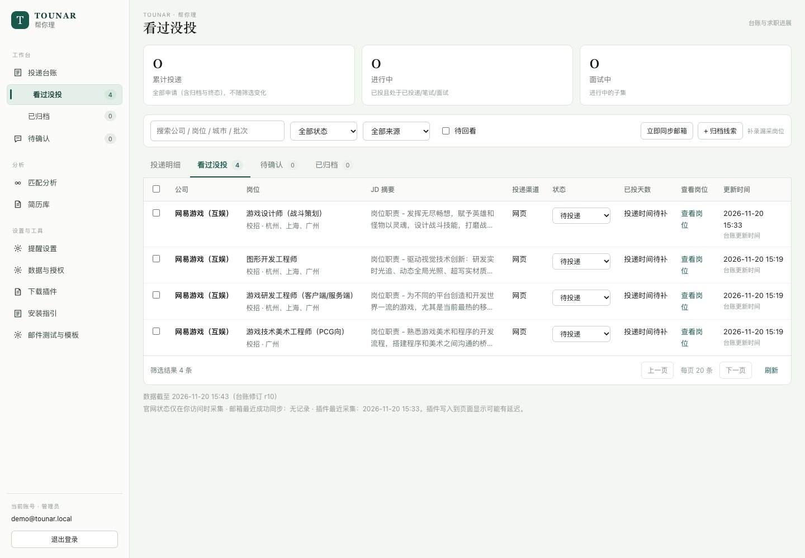
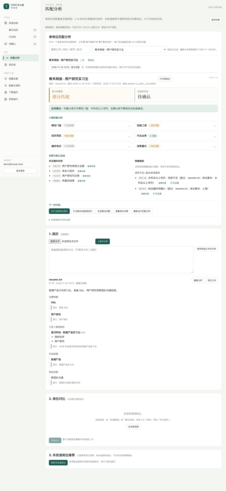
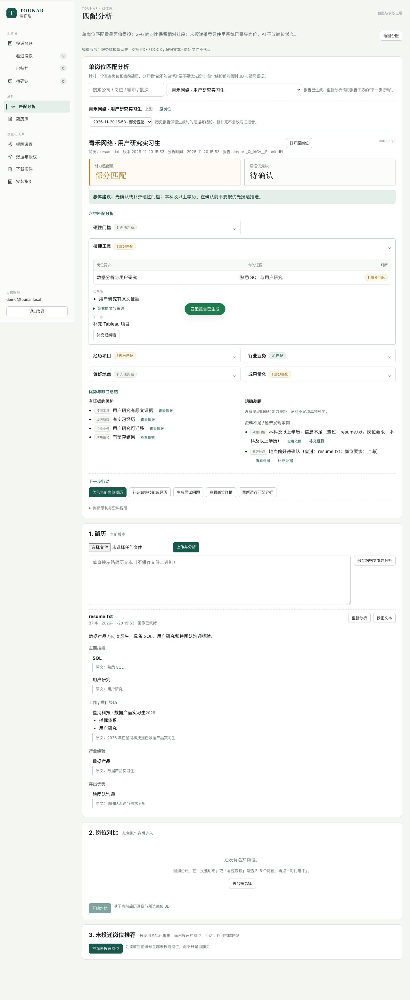
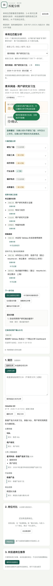
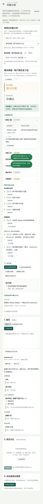

# 网易互娱采集与单岗报告 UX 修复结果（2026-11-20）

基线：`aa50211`，插件 `0.2.11`。

对应任务：`docs/CAPTURE-AND-MATCH-UX-REPAIR-PLAN-20261120.md`

## 一、任务 A：网易互娱 campus.game.163.com

### 1. 新采集路径

新增独立适配器 `netease-game`，只匹配：

```text
https://campus.game.163.com/app/detail/index?id=<数字>&projectId=102
```

- 公司只由该已验证详情模板/招聘目录提供：`网易游戏（互娱）`；不把整个 `163.com` 映射成同一雇主。
- 正式岗位名取 `.position-header-left .position-title > span:first-of-type`；同名层级的 `ant-tag` 标签不进入标题。
- 标题保留括号、斜线、连字符和正式名称内空格；不做“游戏热爱”等删词表。
- 工作地点从 `.u-job-details` 的 `工作地点` 相邻 `desc` 读取，保留全部城市。
- JD 只把 `岗位描述/岗位要求` 段拼成完整正文；摘要优先取职责段的职责原句，不再从公司介绍开头复制。
- 规则采集和模型候选共用同一份字段证据；模型候选中，带标签的父节点被丢弃。
- 字段来源分别落 `company_name`、`job_title`、`location`、`jd_summary`，可区分 `adapter_company`、`recruitment_detail_panel`、`verified_refine`、缺证等。

### 2. 四条官网回归值

| 官网 ID | 公司 | 纯岗位名 | 城市 |
|---|---|---|---|
| 4721 | 网易游戏（互娱） | 游戏设计师（战斗策划） | 杭州、上海、广州 |
| 4739 | 网易游戏（互娱） | 图形开发工程师 | 杭州、上海、广州 |
| 4731 | 网易游戏（互娱） | 游戏研发工程师（客户端/服务端） | 杭州、上海、广州 |
| 4765 | 网易游戏（互娱） | 游戏技术美术工程师（PCG向） | 广州 |

真实渲染页面 + 实际 `adapters.js/tracker.js` 读取四条，字段均正确；摘要分别是各岗职责段，不再共用公司介绍。

离线固定 DOM 回归覆盖三种模式：

- 规则模式
- 模型启用（候选只含独立名称，不含父节点标签）
- 模型失败（回退规则字段）

结果：**60/60**，见 `docs/evidence/capture-match-ux-20261120/netease-game-fixtures.log`。

模型证据反例另加在 `server/test/jd-extraction.test.js`：标题与标签同父节点时，父候选被拒绝，独立名称候选保留。

### 3. 存量四条修复

隔离库：`/Users/mingenlin/tounar-acceptance/20261120-real-resume-selftest`

修复工具：

```text
server/scripts/repair-netease-game-records.js
```

- 按 owner + `campus.game.163.com/app/detail/index` + 数字 ID/规范链接匹配。
- 公司、标题、城市、JD 摘要逐字段更新；人工来源字段跳过；冲突只报告。
- 保留原 application ID、状态、投递事实、邮件关联和旧报告快照。
- 修复写入 `application_history`，来源为 `plugin`，字段来源 `high`，并带 `netease_game_*` source detail。
- 第二次执行零变更；跨 `generic → netease-game` 重访命中同一 application ID，未新增第五条。

修复前后摘要：

| application ID | 岗位 ID | 前标题 | 后标题 | 公司 | 城市 |
|---|---|---|---|---|---|
| `app_5vRdNHea0Lhp_ZWJ` | 4721 | 游戏设计师（战斗策划） 游戏热爱 | 游戏设计师（战斗策划） | 网易游戏（互娱） | 杭州、上海、广州 |
| `app_QHNni0V8W5xNVQZj` | 4739 | 图形开发工程师 实时光追 前沿技术探索 图形引擎 渲染 全局光照 | 图形开发工程师 | 网易游戏（互娱） | 杭州、上海、广州 |
| `app_v91TMaf0PyhxHvCV` | 4731 | 游戏研发工程师（客户端/服务端） | 游戏研发工程师（客户端/服务端） | 网易游戏（互娱） | 杭州、上海、广州 |
| `app_IYc07JlI2Y0FOWun` | 4765 | 游戏技术美术工程师（PCG向） TA程序向 PCG生成 | 游戏技术美术工程师（PCG向） | 网易游戏（互娱） | 广州 |

完整预览/执行 JSON：`docs/evidence/capture-match-ux-20261120/netease-game-repair-preview.json`、`netease-game-repair-apply.json`。

注意：这是一次隔离验收库修复，实际用户库仍需在备份/预演后单独执行。

## 二、任务 B：单岗报告先读结论

`web/assets/js/views/career.js` 改为：

- 顶部两张卡只显示“能力匹配度 · 结论”和“投递优先级 · 结论”，去掉卡内摘要、依据和模型说明。
- 总体建议保留一句；有明确硬冲突时显示首项和总数，并提供「查看门槛」。
- 六维改成六张紧凑按钮卡，默认全部收起：
  - 桌面两列、手机一列。
  - 整行按钮可点击；一次只展开一张；再点同一张收起。
  - 展开详情占可用全宽，承接在该行下方。
- 移除独立“硬性门槛检查”区；硬性门槛详情只在硬性门槛卡片展开后出现。
- 硬性门槛展开为“岗位要求｜你的对应信息｜结果｜判断依据”表；JD 原文、简历原文可展开。
- 其余五维使用“岗位要求｜你的证据｜判断”三列；下面给已具备、待补证/明确缺口、下一步、查看原文与来源、补充或纠错。
- 优势与缺口中的「查看依据」会展开并定位目标维度；用户确认补充有标记。
- 展开、收起、定位均为本地 DOM 操作，不调用模型、不写业务数据。
- 旧 `match-v1` 报告显示重新分析提示；新报告为 `match-v2`。

### 判断问题的独立修复

- 岗位技能、研究方向、职责描述和普通任职要求不再当作硬门槛。
- 只有明确硬性措辞或工作许可/强制地点/学历/年限/证书等类别才进入 `hard_gates`。
- 缺少提及、专业名称不同、经验描述不详不会单凭“未呈现”判 `不满足`；降为 `信息不足`/需要确认。
- 旧报告不清洗；重新分析生成新报告。

测试：`server/test/career-ai.test.js` 新增研究方向反例。

## 三、回归结果

| 套件 | 结果 |
|---|---:|
| `npm test` | 195/196；仅既有云快照 `加密云快照…损坏与冲突拒绝` 失败（云快照用例本轮/前轮不稳定） |
| `npm run test:web` | 63/63 |
| `npm run test:career-ai` | 42/42 |
| `npm run test:netease-game` | 60/60 |
| `npm run test:mail-admin` | 通过 |
| `npm run test:panel` | 8/8 |
| `npm run test:e2e` | 67/67 |

## 四、插件包与实机自测

- 清单版本：`0.2.11`
- 生产包：`web/downloads/bangnili-extension-0.2.11.zip`（SHA-256 `6fca06ff861848aef897c8542dcf1d64274c9f3d0d41044c4b5aecb35602ad64`）
- 本地 4324 自测包：`.tmp/tounar-local-extension-0.2.11.zip`（已指向 `http://127.0.0.1:4324`，SHA-256 `030d0473bd8e8044b470ae9674b9de26278f9cec1ef31f5cee6bdc1430ec9c83`）
- 本地包解压后加载 `bangnili-extension`；生产包按 web 下载入口安装。
- 四岗实站字段已用真实渲染 DOM + 实际 `adapters.js/tracker.js` 验证；完整扩展安装 + 网页授权 + 配对链路仍需按隔离实例重新走一遍后标记实站通过。

## 四、截图

### 修复后四岗台账



### 单岗报告收起 / 展开









## 五、仍未覆盖

- 四岗实站完整 Chrome 扩展安装 + 网页授权 + 配对链路本轮未在真实账号上从头跑完；已用真实渲染 DOM + 实际 adapters/tracker 脚本，以及三模式固定 DOM 验证字段与模型回退。正式自测需要安装 `0.2.11` 并记录包版本。
- 旧报告不会被重写；用户需重新分析才能获得新版门槛和折叠结构。
- 当前没有评审通过的评分/权重/百分比；继续只输出文字结论。
