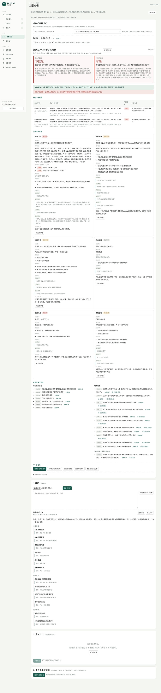
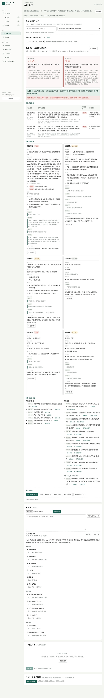
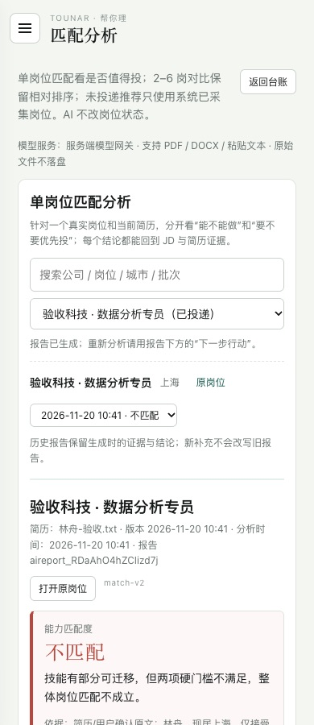
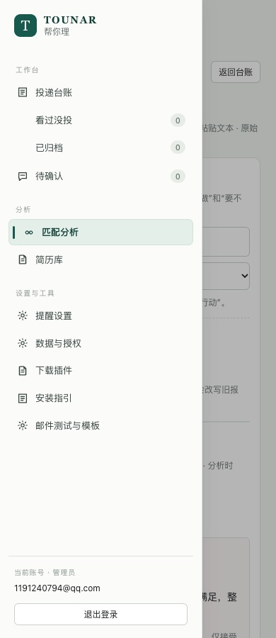
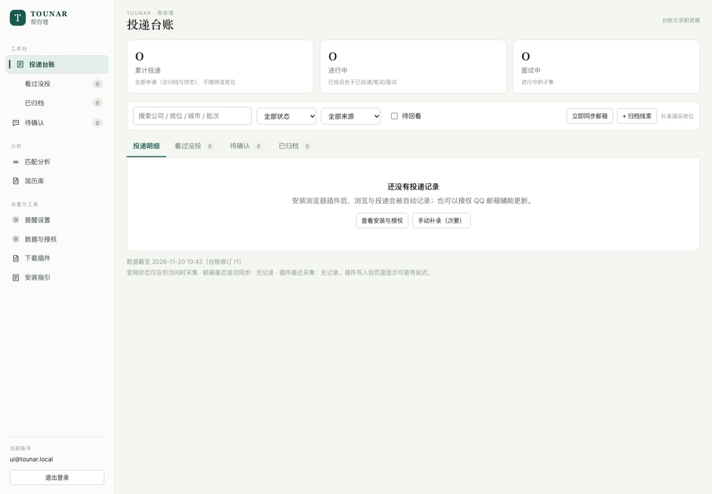

# 修复记录｜侧栏与单岗位匹配验收问题（2026-11-20）

复核基线：`9bf7501`
对照：`docs/SIDEBAR-AND-RESUME-MATCH-ACCEPTANCE-20261120.md`

本轮按“先 P0、再 P1、最后 P2”修复。历史报告不重写；新版匹配报告使用 `match-v2`，旧报告在页面明确标注“需重新分析”。

## 一、P0：硬门槛与投递建议使用同一份核验结果

### 修复内容

`server/src/modules/career-ai/llm.js` 增加保守的门槛发现与统一的 `evaluateGate`：

- JD 条件分类：工作许可、地点/线下、学历、年限/领域、证书资格、其他必须条件。
- 普通“工作地点上海”不升级为硬门槛；只有明确线下/现场/坐班/到岗等要求才进入门槛。
- “优先/加分/更佳/非必须”不会被当成硬要求；同一行其他软条件不会抹掉前面的硬条件。
- 满足/不满足必须由对应用户侧原文支持：
  - “仅接受远程”与强制线下冲突 → `不满足`。
  - “尚未取得中国境内工作许可” → `不满足`。
  - “持有美国工作许可”但没有中国境内许可 → `信息不足`，不冒充满足。
  - “5 年销售经验”不能满足“3 年以上数据产品经验” → `信息不足`，不冒充满足。
  - 省略许可信息 → `信息不足`。
  - 模型返回“无用户证据的不满足” → 降为 `信息不足`，不再阻断。
- 顶部能力结论、投递优先级、优先级依据、总体建议、六维门槛汇总由同一份 `hard_gates` 生成，避免“暂缓但建议立即优先投递”。
- 有 `不满足` 时优先级强制“暂缓”，总体建议不再拼接模型原文；有需要确认/信息不足时不能给出“优先投/适合投”。

### 反例回归

`server/test/career-ai.test.js` 新增：

- 远程冲突 + 无工作许可：两项均为 `不满足`，优先级 `暂缓`，总体建议无“立即优先”。
- 软要求 + 普通地点：不产生硬门槛。
- 境外许可、不同领域年限：不判满足。
- 全部满足：所有门槛一致为满足，六维门槛卡为匹配。
- 模型无用户证据的“不满足”：不进入阻断，优先级依据不再出现“没有阻断”。
- 失实引文、伪造收益：不进入事实结论。

## 二、P0：优势、缺口与顶部依据逐条绑定证据

### 修复内容

- 维度结论为肯定时必须存在用户侧证据（简历或用户确认补充）；只有 JD 引文不能支撑“匹配”。
- 优势/缺口文本要经过用户侧（缺口可同时用 JD）的来源核验：
  - 数字必须能在对应用户原文或 JD 原文找到；`100 万` 等未出现收益被过滤。
  - `Tableau` 等技能词若只出现在 JD 或模型文本、没有用户侧原文，不能进入优势。
- 用户事实 `user_evidence` 若包含未核验技能/数字，替换为已核验引文。
- 顶层能力摘要/依据、投递优先级摘要/依据、总体建议使用同一套核验；不可核验的模型表述被替换。
- 面试问题也传入简历原文，问题或依据中的未核验数字/技能会被丢弃。
- 摘要中的每条优势/缺口可“查看依据”，滚动到对应维度并显示带来源标签的引文；用户确认补充有专门标记。
- 简历优化改为逐条卡片：原简历段落 / 对应 JD 要求 / 可编辑建议 / 复制按钮；不自动写入简历。

### 反例回归

- 只返回 JD 引文却声称“Tableau 项目增加营收 100 万”：维度降为“无法判断”，优势为空，顶部不出现 Tableau/100 万。
- 有 SQL 用户证据但优势里塞入 Tableau/100 万：伪造收益和技能被过滤，用户事实回落到 SQL 引文。
- 旧报告仍保留原结论；新版报告记录 `match-v2`，旧结构报告显示重新分析提示。

## 三、P1：导航选中态与移动端键盘

- `renderLedger` 切换旧页签时同步更新 URL、侧栏选中项、页标题和 `aria-current`。
- 侧栏与台账页签共用同一当前视图；从“看过没投”切到“待确认”，侧栏不会再停留在“投递台账”。
- 移动端关闭态给侧栏设置 `inert`，打开态给工作区设置 `inert`，Tab/Shift+Tab 在抽屉内循环，Esc 关闭并把焦点还给菜单按钮。
- 通用 `openModal` 增加 Tab 焦点循环、初始聚焦和关闭后焦点恢复；提醒/设置弹窗不会再 Tab 逃到背景。
- 旧页签切换、刷新、深链、前后导航保留原路由；新增测试覆盖左侧状态与 aria-current。

## 四、P1：单岗选择、分页与历史竞态

- 单岗位匹配增加搜索框，复用台账 API 的 `q`、`limit`、`cursor`；当前列表每页 50，两个视图分别保留下一页游标。
- “加载更多岗位”可继续读取后续台账；测试创建 101 条同视图岗位并搜索到第一页之外。
- 详情带入的岗位仍会补入选择器。
- 历史报告请求使用递增序号；先点 A 再点 B 时，A 的迟到响应不能覆盖 B。
- 失败/未完成报告显示独立状态卡，不会渲染成完成报告。

## 五、P1：对比选中恢复为一次显式运行

- 台账“对比选中”链接携带 `autorun=compare`。
- 进入 AI 页后消费该标记：只自动运行一次，并立即从 URL 移除。
- 直接访问旧 `?panel=career&apps=` 深链、刷新已消费 URL 不自动重跑。
- 测试同时校验模型调用次数：主动对比 +1，旧深链 0 次，刷新 0 次。

## 六、P2：阅读顺序与行动

- 移除了报告头部重复的“重新运行匹配分析”；只保留报告下方的“下一步行动”入口和失败报告的重试入口。
- 简历优化按维度逐条展示原简历引文、JD 要求、建议文本，支持编辑和复制，不自动改原文。
- 保留五项行动：优化简历、补充经历、生成面试问题、查看岗位详情、重新运行匹配分析。
- 查看详情使用抽屉，关闭后仍在原报告；测试覆盖正确岗位和返回位置。

## 七、报告版本与旧报告

- 新报告：`report_version=match-v2`、`schema_version=match-context-v2`。
- 旧 `match-v1` 报告仍可读取，但页面显示“生成于证据核验修复前，建议重新运行”，不把它当成已按新规则重新核验。
- 数据库 `ai_reports` 迁移、`ai_match_corrections` 表、旧报告保留逻辑不变。

## 八、实际测试结果

| 命令 | 结果 |
|---|---|
| `npm test` | **193/194**；仅既有云快照用例 `加密云快照…损坏与冲突拒绝` 失败，改动前已存在 |
| `npm run test:web` | **63/63** |
| `npm run test:career-ai` | **41/41** |
| `npm run test:mail-admin` | 通过 |
| `npm run test:panel` | **8/8** |
| `npm run test:e2e` | **67/67** |
| `npm run test:plugin-acceptance` | 未作为本轮门禁；基线 `9a0e7fd` 的同套件已复现 12 个既有扩展 fixture/模板失败，本次未改扩展 |

真实 DeepSeek 验收（隔离 4325，虚构简历/JD）：

- 简历：只有 SQL 基础、用户访谈和漏斗复盘；明确“仅接受远程、尚未取得中国境内工作许可”。
- JD：强制上海线下、强制中国境内工作许可、SQL/Tableau、零售优先。
- 报告：`aireport_RDaAhO4hZCIizd7j`，`match-v2`，约 26 秒。
- 结果：工作许可、线下办公两项 `不满足`；能力“不匹配”，优先级“暂缓”；总体建议为“先处理硬性门槛…暂不要按优先投递推进”。
- 简历中无 Tableau 和量化收益，报告未把它们写成事实；岗位仍为 `applied`，投递日期/历史未变化。

## 九、截图

## 十、仍待产品确认

- 匹配结论继续使用枚举文字，不引入未批准的分数、权重、区间或录用概率。
- 兜底门槛规则针对常见中文 JD；复杂/英文 JD 仍依赖模型抽取和服务端逐字引文校验。
- “仅接受远程”按明确冲突判 `不满足`；如果产品希望改为“需要用户确认”，只改门槛结论映射，不改变阻断优先级的安全边界。
