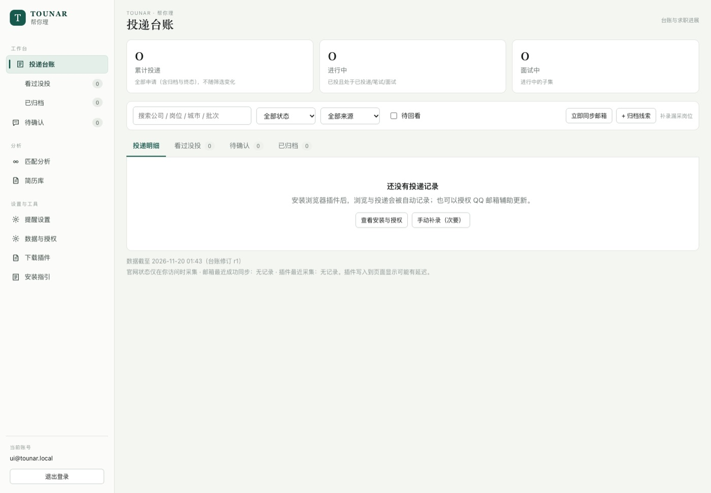
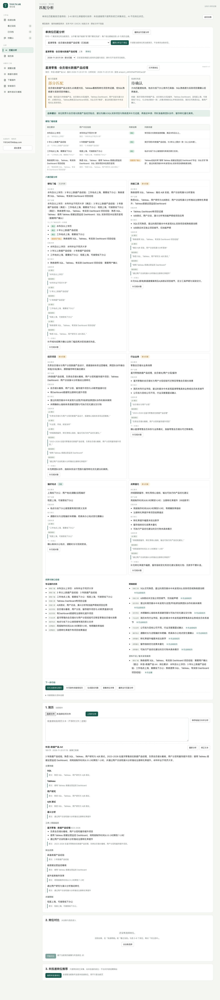
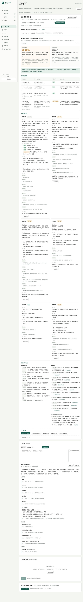
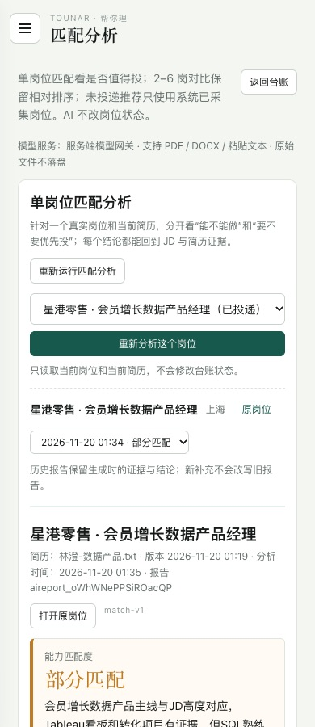
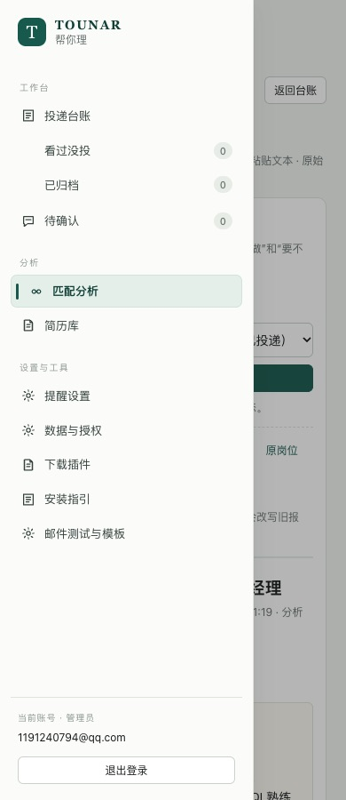

# 交付记录｜左侧导航与单岗位简历匹配（2026-11-20）

对应提示词：`docs/SIDEBAR-AND-RESUME-MATCH-DEV-PROMPT-20261120.md`

本次改动分成两个可独立验收的交付面：

1. 左侧导航工作区迁移，保留原台账、待确认、简历/AI、设置、旧深链和移动端操作。
2. 单岗位匹配报告与“用户确认补充”闭环，保留原 2–6 岗对比和未投递推荐。

## 一、入口映射

| 侧栏 | 新入口 | 对应原功能 |
|---|---|---|
| 投递台账 | `/?panel=ledger`（默认 `/?`） | 投递明细、三项统计、搜索/筛选/分页、补录、状态直改、跨页勾选 |
| 看过没投 | `/?panel=ledger&view=viewed` | 原台账子视图 |
| 已归档 | `/?panel=ledger&view=archived` | 原台账子视图 |
| 待确认 | `/?panel=reviews` | 原 `reviews` 视图；侧栏徽标使用 `counts.pending_review` |
| 匹配分析 | `/?panel=career&section=match` | 单岗位匹配 + 原岗位对比 + 未投递推荐 |
| 简历库 | `/?panel=career&section=resume` | 上传、粘贴、修正、分析、画像、版本列表 |
| 设置与工具 | 侧栏按钮 | 提醒设置、数据与授权、插件下载/安装指引、管理员邮件测试 |
| 账号 | 侧栏底部 | 当前邮箱（长值截断 + `title` 完整值）、退出确认 |

保留的旧链接：

- `/?app=<id>`
- `/?panel=reviews`
- `/?panel=settings`
- `/?panel=career&apps=<ids>`
- `/?panel=mail-admin`
- `/?panel=plugin-connect`、`/?panel=plugin-sites`
- `/r/<token>` 登录/提醒落地页

实现说明：

- `web/assets/js/app.js` 新增 `buildShell`：桌面为 232px 左侧栏 + 工作区；移动端（≤900px）为可关闭抽屉，`Esc` 关闭并把焦点还给菜单按钮。
- 侧栏只读取 `counts` 事件和一次台账计数 GET；失败保持未知并隐藏徽标，不显示假 `0`。
- 台账内部 tab 仍保留，旧测试和原有操作路径没有移除；侧栏只是新增一层稳定入口。
- 打开匹配页、切换选择、刷新页面不再自动发起模型分析；原 2–6 岗对比自动运行也已去掉，必须由用户点按钮触发，避免刷新重复消耗模型。

## 二、单岗位匹配

### 服务端

新增兼容接口（原 compare/recommend 契约不变）：

| 方法 | 路径 | 说明 |
|---|---|---|
| POST | `/api/v1/ai/match` | 单岗位报告；支持 `application_id`、可选 `parent_report_id` |
| GET | `/api/v1/ai/match-reports?application_id=` | 本人该岗位的历史报告 |
| GET | `/api/v1/ai/reports/:id` | 原报告接口；match 报告附带适用的用户确认补充 |
| POST | `/api/v1/ai/reports/:id/corrections` | 追加“用户确认补充”，幂等键保护 |
| GET | `/api/v1/ai/reports/:id/corrections` | 读取该报告直接保存的补充 |
| POST | `/api/v1/ai/reports/:id/interview-questions` | 基于报告快照生成面试问题 |

单岗位报告保存：

- 账号隔离：所有读取/写入先按 `owner_id` 校验。
- 岗位和简历版本：报告头显示公司、岗位、简历文件名/版本时间、分析时间。
- 证据快照：`context_json` 保存 `match-context-v1`（岗位 JD、简历画像、简历文本、当时使用的补充证据）。
- 结构版本：`report_version=match-v1`。
- 重跑关联：新报告记录 `parent_report_id`，旧报告结果不被改写。
- 历史报告：`ai_reports.kind='match'`，重启/刷新后可通过历史选择重新读取。

报告结构：

1. 核心匹配结论：能力匹配度 + 投递优先级，各有结论、摘要、依据和总体建议。
2. 硬性门槛：岗位要求 / 用户对应信息 / 满足 / 不满足 / 信息不足 / 需要用户确认 / 依据；JD 没有逐字依据的门槛会被丢弃。
3. 六维：硬性门槛、技能工具、经历项目、行业业务、偏好地点、成果量化；每卡含要求、用户证据、结论、优势、缺口、证据来源、下一步。
4. 优势与缺口：按维度回链；区分“明确差距”和“资料不足 / 暂未发现案例”。
5. 下一步行动：优化简历（可编辑建议、原文不改）、补充缺口、面试问题、查看岗位详情（抽屉，不丢报告）、重跑。

判断约束：

- 服务端只接受枚举结论；不输出百分比、评分、权重、录用概率。
- 模型返回的引文必须逐字出现在对应 JD、简历或用户确认补充中；失实引文丢弃，肯定结论降为“无法判断”。
- 有 `不满足` 硬门槛时强制优先级为“暂缓”；有门槛需要确认/信息不足时不得给出“优先投/适合投”。
- 对常见中文 JD 的学历、最低年限、指定城市线下办公、许可证等增加保守的原文门槛补充；只从 JD 逐字线索发现，不从缺失推断“不满足”。

### 纠错闭环

`ai_match_corrections` 只追加用户明确确认的一段补充：

- 原判断、用户补充、写入字段、适用范围会先在弹窗中预览。
- 取消不发请求；确认后才保存；双击保存被禁用，服务端唯一约束防止重复。
- 不修改简历原文、不重置画像、不改投递状态/日期/历史/提醒。
- 适用范围可选“仅此岗位”/“以后所有匹配”。
- 新报告可引用；旧报告保留生成时结论和证据，且可看到后续补充。
- 账号删除时随报告级联清理。

### 数据库迁移

- `ai_reports.kind` CHECK 增加 `match`；新库直接创建。
- 旧库启动时检测 CHECK 不含 `match`，SQLite 重建表并保留旧报告。
- 新列：`parent_report_id`、`report_version`、`context_json`。
- 新表：`ai_match_corrections`。
- 迁移测试：`server/test/career-ai-migration.test.js`。

## 三、实际执行结果

| 命令 | 结果 |
|---|---|
| `npm test` | **188/189**；本轮仅失败既有云快照用例 `加密云快照…损坏与冲突拒绝`（同两组云快照用例历史上均不稳定；改动前已存在） |
| `npm run test:web` | **59/59** |
| `npm run test:career-ai` | **27/27**（含侧栏、单岗报告、刷新不重跑模型、纠错、重跑、面试问题、移动端） |
| `npm run test:mail-admin` | 通过 |
| `npm run test:panel` | **8/8** |
| `npm run test:e2e` | **67/67** |
| `npm run test:plugin-acceptance` | **6/18**，12 个失败；用基线 `9a0e7fd` 单独工作树复跑同样 12 个失败，属于既有扩展 fixture/模板问题，不是本次 Web/报告改动引入 |

真实模型验收（隔离 4323，真实 DeepSeek Flash）：

- 真实简历分析：`grounded=true`，技能含 SQL、Tableau、用户研究、A/B 测试、漏斗分析。
- 真实单岗位报告：`aireport_oWhWNePPSiROacQP`。
- 用时约 49.6 秒；`source=openai_compatible`。
- 硬门槛 4 条：本科满足、3 年经验满足、上海线下满足、SQL/Tableau 熟练度需要用户确认。
- 结论：能力“部分匹配”、优先级“待确认”；岗位状态仍为 `applied`，未改动投递。
- 真实报告及界面截图见 `docs/evidence/sidebar-match-20261120/`。

截图：

- `ledger-sidebar-1440.jpg`：新侧栏 + 台账工作区
- `match-real-desktop-1440.jpg`：真实模型单岗报告桌面
- `match-real-tablet-1024.jpg`：1024px
- `match-real-mobile-390.jpg`：390px 单岗报告顶部
- `match-real-mobile-nav-390.jpg`：390px 导航抽屉

### 截图文件

## 四、产品待定项（不在本次擅自定公式）

- 能力匹配和投递优先级目前是**有证据的文字结论**，没有未批准的数字分数、权重、区间或录用概率。
- 偏好地点只在简历/用户确认中有明确依据时参与；没有确认时优先展示“待确认”，不推断城市、通勤或远程偏好。
- 常见中文硬门槛有保守补充规则；复杂/英文 JD 仍主要依赖模型抽取与逐字引文核验。
- “优化当前岗位简历”只生成可编辑建议，不在报告内直接改写简历；正式修改仍走原简历文本修正与重新分析。

## 五、已知环境限制

- 两个云快照用例在改动前即存在不稳定；本轮只失败 `加密云快照…损坏与冲突拒绝`，`HTTP 全链路…云快照恢复` 本轮通过；本次未触碰相关模块。
- 真实浏览器安装、Chrome 原生首次授权拒绝等仍以既有扩展验收边界为准。
- 4323 是隔离真实模型验收库，不包含生产邮件/台账数据；生产实例未修改。
